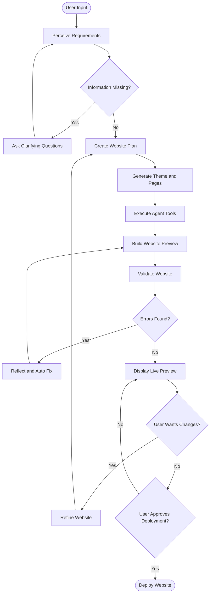

# 🚀 WebForge AI – An AI Agent That Builds Websites from Natural Language Prompts

<p align="center">
  
  
  
  
</p>

<p align="center">
  <b>Turn your ideas into fully functional websites using simple natural language prompts.</b>
</p>

---

## 🌟 Overview

**WebForge AI** is an autonomous, tool-using AI agent designed to build complete, responsive and SEO-friendly websites from natural language descriptions.

Unlike traditional AI website generators that produce a one-time output, WebForge AI follows an intelligent agent-based approach. It understands user requirements, asks clarifying questions, creates a structured plan, generates website pages, validates the output, identifies errors and automatically improves the website.

Users can interact with the agent through a conversational interface, preview generated websites in real time and request modifications without writing code.

### 💡 Example

**User Prompt:**
> Create a modern website for a real estate agency with property listings, an about page and a contact form.

**WebForge AI will:**
1. Understand the user's requirements.
2. Ask questions if important information is missing.
3. Generate a website structure and development plan.
4. Create pages, themes, layouts and content.
5. Validate the generated website.
6. Automatically fix detected issues.
7. Display a live website preview.
8. Allow users to modify and deploy the website.

---

## ✨ Key Features

| Feature | Description |
|---|---|
| 🧠 AI Agent | Understands natural language requirements. |
| 📋 Autonomous Planning | Creates website specifications and task lists. |
| 🎨 Theme Generation | Generates colours, fonts and layouts. |
| 🌐 Website Generation | Builds complete multi-page websites. |
| 🖼️ Image Integration | Fetches suitable images for website sections. |
| 🔍 Self-Validation | Checks HTML, links, SEO and accessibility. |
| 🔧 Automatic Error Fixing | Detects and repairs website issues. |
| 💬 Chat-Based Editing | Modifies websites through conversational prompts. |
| 👁️ Live Preview | Displays generated websites in real time. |
| 💾 Version History | Saves previous website versions and supports undo. |
| 🚀 Deployment | Supports deployment after user approval. |

---

## 🧠 How WebForge AI Works

WebForge AI follows an intelligent agent workflow based on:

**Perceive → Plan → Act → Observe → Reflect → Present**

### Agent Workflow



---

## 🏗️ System Architecture

The project follows a layered architecture consisting of the following components:

1. **Frontend Layer:** React-based user interface with chat functionality, dashboard and live website preview.
2. **API Layer:** FastAPI gateway responsible for authentication, requests and communication.
3. **Agent Layer:** Controller, intent parser, planner, executor, critic and memory manager.
4. **Tool Layer:** Website generation, theme generation, image fetching, validation and deployment tools.
5. **AI Layer:** Large Language Model API for reasoning, planning and code generation.
6. **Database Layer:** PostgreSQL for user data, projects, versions and agent memory.
7. **Deployment Layer:** Hosting integration with platforms such as Vercel or Netlify.

---

## 🛠️ Technology Stack

| Category | Technologies |
|---|---|
| Frontend | React.js, Tailwind CSS |
| Backend | Python, FastAPI |
| AI / LLM | LLM APIs, Function Calling, Prompt Engineering |
| Agent Architecture | ReAct, Plan-and-Execute, Reflection |
| Database | PostgreSQL |
| Authentication | JWT |
| Real-Time Communication | Server-Sent Events (SSE) |
| Image Integration | Image Generation / Stock Image APIs |
| Deployment | Vercel / Netlify |
| Version Control | Git & GitHub |

---

## 🔄 AI Agent Tools

WebForge AI uses multiple tools to complete website generation tasks.

| Tool | Responsibility |
|---|---|
| `ask_user` | Asks questions to clarify requirements. |
| `plan_site` | Generates website specifications and task lists. |
| `generate_theme` | Creates website themes and CSS tokens. |
| `generate_page` | Generates HTML pages and content. |
| `edit_page` | Applies changes to existing pages. |
| `fetch_image` | Finds or generates suitable website images. |
| `build_preview` | Builds a previewable website. |
| `validate_site` | Checks website quality and errors. |
| `save_version` | Saves website versions. |
| `restore_version` | Restores previous versions. |
| `deploy_site` | Deploys the approved website. |
| `export_zip` | Exports the generated website as a ZIP file. |

---

## 🎯 Project Objectives

- Generate a website from a natural language prompt.
- Reduce the need for manual coding and designing.
- Build responsive multi-page websites.
- Implement autonomous planning and execution.
- Introduce self-reflection and automatic error correction.
- Provide conversational website customization.
- Enable live preview and user-approved deployment.

### Performance Targets

| Metric | Target |
|---|---|
| First Website Preview | ≤ 60 seconds |
| Website Refinement | ≤ 20 seconds |
| Lighthouse Score | ≥ 90 |
| Tool Call Success Rate | ≥ 95% |
| Maximum Agent Iterations | 8 |
| Automatic Fix Cycles | 3 |

*These are project targets defined in the synopsis, not claims of measured performance.*

---

## 📂 Project Structure

The following is a suggested logical structure for organizing the project. Adjust it according to your actual repository.

```text
WebForge-AI/
│
├── frontend/
│   ├── src/
│   │   ├── components/
│   │   ├── pages/
│   │   ├── assets/
│   │   └── App.jsx
│   └── package.json
│
├── backend/
│   ├── agent/
│   │   ├── controller.py
│   │   ├── planner.py
│   │   ├── executor.py
│   │   ├── critic.py
│   │   └── memory.py
│   │
│   ├── tools/
│   │   ├── generate_theme.py
│   │   ├── generate_page.py
│   │   ├── edit_page.py
│   │   ├── validate_site.py
│   │   └── deploy_site.py
│   │
│   ├── api/
│   ├── database/
│   └── main.py
│
├── generated_sites/
├── tests/
├── docs/
├── .env.example
├── .gitignore
└── README.md
```

---

## ⚙️ Installation & Setup

### 1. Clone the Repository

```bash
git clone https://github.com/Shaileshgole08/An-AI-Agent-That-Builds-Websites-from-Natural-Language-Prompts.git
```

### 2. Navigate to the Project

```bash
cd An-AI-Agent-That-Builds-Websites-from-Natural-Language-Prompts
```

### 3. Install Dependencies

Install frontend and backend dependencies according to their respective `package.json` and Python dependency files.

### 4. Configure Environment Variables

Create a `.env` file and configure the required API keys and database settings.

```env
LLM_API_KEY=your_llm_api_key
DATABASE_URL=your_database_url
JWT_SECRET=your_secret_key
IMAGE_API_KEY=your_image_api_key
```

**Important:** Never upload your actual API keys or `.env` file to GitHub.

### 5. Run the Application

Start the backend and frontend using the development commands configured in their respective project folders.

---

## 🔐 Security & Reliability

WebForge AI incorporates several safety mechanisms:

- Input validation and content moderation.
- Prompt injection protection.
- Restricted tool execution using an allow-list.
- Maximum 8 agent iterations per run.
- Maximum 3 automatic correction cycles.
- Sanitization of generated HTML and CSS.
- Sandboxed website preview.
- User approval before deployment.
- Secure server-side API key management.

---

## 🚀 Future Enhancements

- 🌍 Multi-language website generation.
- 🛒 E-commerce website generation.
- 🤖 Personalized AI design recommendations.
- 🔌 Automatic backend and API generation.
- 📊 Website analytics integration.
- 🎨 Advanced design customization.
- ☁️ Improved cloud deployment integration.

---

## 👨‍💻 Developer

**Shailesh Gole**

B.Tech – Computer Science Engineering

Specialization: Artificial Intelligence, Machine Learning and IoT

**Institute:** GLA University

**Team ID:** 43

**Project Type:** Individual Project

### Connect With Me

<p align="left">
<a href="https://github.com/Shaileshgole08">

</a>
</p>

---

## ⭐ Support

If you find this project interesting, consider giving it a ⭐ on GitHub.

Your support motivates further development and innovation!

---

<p align="center">
  <b>WebForge AI – From Natural Language to Functional Websites.</b>
  <br/>
  Made with ❤️ and Artificial Intelligence.
</p>
